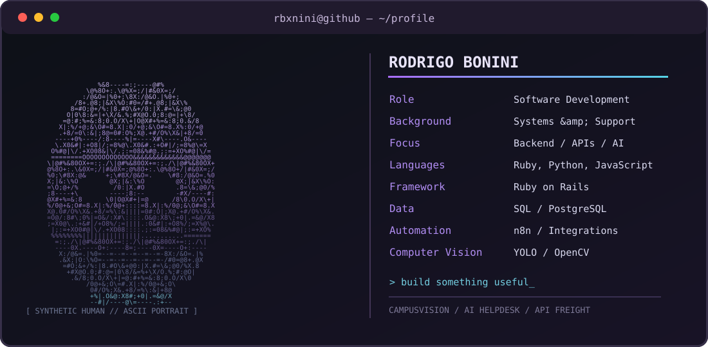

<div align="center">



### Building software that solves real problems.

**Backend Development** · **Automation** · **Artificial Intelligence** · **Accessibility**

</div>

---

### `> about_me`

Trabalho com suporte e análise de sistemas e estou direcionando minha carreira para desenvolvimento de software. Gosto de transformar problemas reais em soluções com código, automação e inteligência artificial.

- Construindo projetos com **Ruby on Rails**, **Python**, **APIs** e bancos de dados.
- Explorando **visão computacional**, **inteligência artificial aplicada** e **acessibilidade**.
- Aprendendo na prática e buscando criar ferramentas que tenham utilidade real.

### `> tech_stack`


### `> featured_projects`

| Projeto | Descrição | Tecnologias |
|---|---|---|
| **[CampusVision](https://github.com/rbxnini/CampusVision)** | Mapeamento de acessibilidade com visão computacional | Python, YOLO, OpenCV |
| **[AI Helpdesk](https://github.com/rbxnini/helpdesk-ai-n8n)** | Automação de transcrição e resumo de atendimentos | n8n, APIs, IA |
| **[API Freight](https://github.com/rbxnini/api-freight)** | Projeto prático de desenvolvimento de APIs | Backend, APIs |

### `> mission`

```text
[+] Evoluir em desenvolvimento backend
[+] Criar integrações e automações úteis
[+] Explorar IA aplicada a problemas reais
[+] Compartilhar o que aprendo construindo
```

<div align="center">

*"Build. Break. Learn. Repeat."*

</div>
