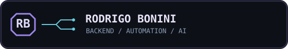

<div align="center">



**Software Development · Backend · Automation · AI**

</div>

### `rbxnini@github:~$ whoami`

```text
       .--------------------.         RODRIGO BONINI
      / .----------------.  \        --------------------------------
     / /   .--------.    \  \       ROLE        Software Development
    | |    |  >_    |     |  |      BACKGROUND  Systems & Support
    | |    |        |     |  |      FOCUS       Backend / APIs / AI
    | |    '--------'     |  |      LANGUAGES   Ruby / Python / JavaScript
    | |   /|  ____  |\    |  |      FRAMEWORK   Ruby on Rails
    | |  / | |____| | \   |  |      DATABASE    SQL / PostgreSQL
    | |  \_|________|_/   |  |      AUTOMATION  n8n / Integrations
     \ \________________/  /       VISION      YOLO / OpenCV
      '--------------------'
           |  _  |
           | | | |
           |_| |_|

     [ SYSTEM ONLINE ]                  > build something useful_
```

### `> about_me`

Trabalho com suporte e análise de sistemas e estou direcionando minha carreira para desenvolvimento de software. Gosto de transformar problemas reais em soluções com código, automação e inteligência artificial.

- **Backend:** Ruby on Rails, Python, APIs e bancos de dados
- **Automação:** n8n, integrações e fluxos inteligentes
- **IA e acessibilidade:** visão computacional, YOLO e OpenCV

### `> featured_projects`

| Projeto | O que faz |
|---|---|
| [CampusVision](https://github.com/rbxnini/CampusVision) | Mapeamento de acessibilidade com visão computacional |
| [AI Helpdesk](https://github.com/rbxnini/helpdesk-ai-n8n) | Automação e resumos de atendimentos com IA |
| [API Freight](https://github.com/rbxnini/api-freight) | Projeto prático de desenvolvimento de APIs |

### `> mission`

```text
[+] Desenvolver soluções úteis
[+] Evoluir em backend e arquitetura de APIs
[+] Criar automações com inteligência artificial
[+] Aprender construindo projetos reais
```

<div align="center">

*Build. Break. Learn. Repeat.*

</div>
